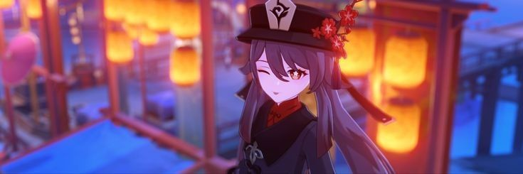
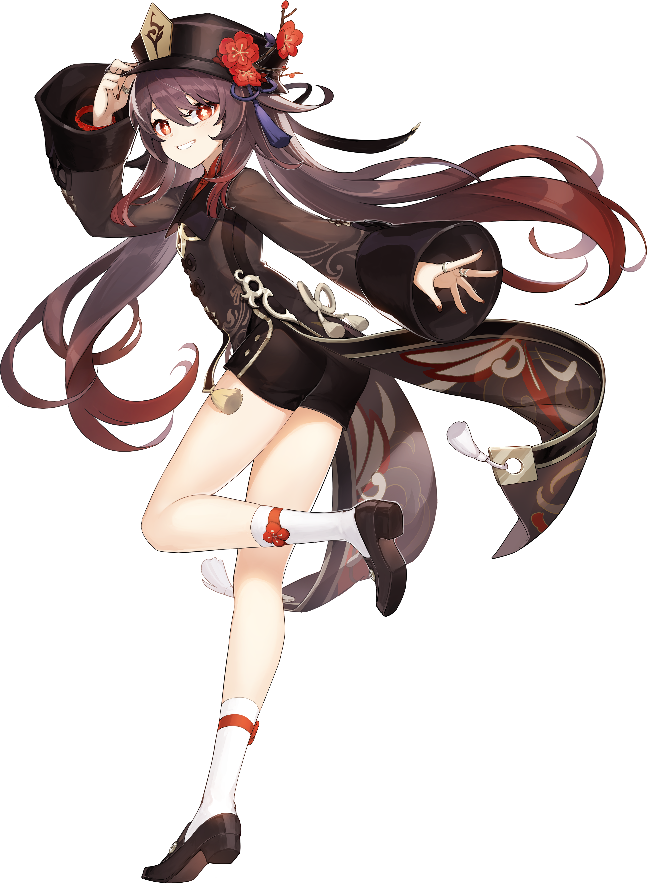

<!-- ==================== BANNER ==================== -->

 

# SADEWA

### JACK OF ALL TRADES, MASTER OF NONE.

*But oftentimes better than a master of one.*

 

  

  

<!-- ==================== ABOUT ME ==================== -->

## 🌸 01 / ABOUT ME

<table>
<tr>
<td width="65%" valign="middle">

### Hi, I'm Sadewa!

An Information Systems student with an interest in technology, web development, and creative problem-solving.

I enjoy exploring different fields, experimenting with new technologies, and turning ideas into something meaningful.

**A little about me:**

- 🎓 Information Systems Student
- 💻 Interested in Frontend Development
- 🌱 Currently learning React & Next.js
- 🎨 Interested in UI/UX Design
- 🎮 Gaming Enthusiast
- 🚀 Always curious, always learning

 

*Dream bigger, code harder.*

</td>

<td width="35%" align="center" valign="middle">

</td>
</tr>
</table>

---

<!-- ==================== TECH STACK ==================== -->

## 🌸 02 / TECH STACK

### LANGUAGES

 

### FRAMEWORKS & LIBRARIES

 

### TOOLS & DESIGN

---

<!-- ==================== PROJECTS ==================== -->

## 🌸 03 / SELECTED WORKS

<table>
<tr>
<td width="100%" valign="top">

### 🖥️ Personal CV Website

A personal portfolio website built with React and Tailwind CSS, featuring a custom visual identity and interactive elements.

**TECH STACK**

  

</td>
</tr>
</table>

 

  

*Some experiments, projects, and things I've built along the way.*

---

<!-- ==================== GITHUB ACTIVITY ==================== -->

## 🌸 04 / GITHUB ACTIVITY

---

<!-- ==================== CONTRIBUTION ==================== -->

## 🌸 05 / CONTRIBUTION

---

<!-- ==================== FOOTER ==================== -->

 

### KEEP EXPLORING. KEEP CREATING.

*One step at a time.*

  

